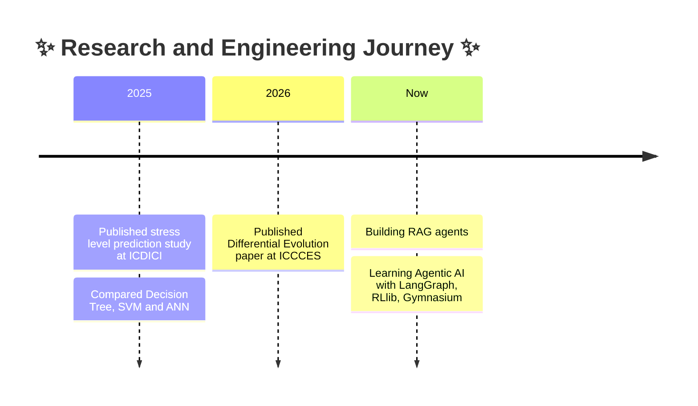
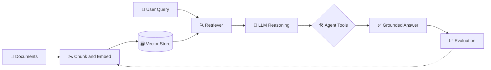

 

 

 

## 🌷 About Me

Hey there! 👋 I'm an ML & AI engineer from India 🇮🇳 who loves building intelligent systems **end to end**: data pipelines → model training → RAG and agent-based apps that are actually ready for production. 🚀

I also write research! 📝 Two of my papers are live on **IEEE Xplore** 💫

| 🌈 | Right now |
|:--|:--|
| 🔭 **Building** | RAG agents |
| 🌱 **Learning** | Agentic AI: LangGraph, RLlib, Gymnasium |
| 🤝 **Open to collab on** | AI agents, applied ML, research projects |
| 📫 **Say hi** | chitreshb376@gmail.com |

 

## 📚 Research & Publications

<table>
<tr>
<td width="50%" valign="top">

### 🧠 Publication 1

**Predicting Human Stress Levels with Supervised Learning: A Performance-Based Study**
*ICDICI 2025 · Tirunelveli, India · July 2025*

An ML framework that classifies stress as low, medium or high from heart rate, sleep, screen time, physical activity and caffeine intake. Decision Tree, SVM and ANN were compared on an 80:20 split, with confusion matrices and 2D/3D visualizations. 💜

`Machine Learning` `Healthcare AI` `SVM` `Neural Networks`

</td>
<td width="50%" valign="top">

### 📡 Publication 2

<!-- TODO: replace this working title with the exact title shown on IEEE Xplore -->
**Differential Evolution-Based Resource Optimization for Computer Networks**
*ICCCES 2026 · Coimbatore, India · January 2026*

A Differential Evolution model, simulated in MATLAB, that balances bandwidth, CPU, memory, power and buffer allocation to maximize throughput and minimize cost using mutation, crossover and selection. 🧬

`Optimization` `Differential Evolution` `MATLAB` `Computer Networks`

</td>
</tr>
</table>

 

## 🗺️ My Journey

 

## 🧩 How My RAG Agents Think

<b>🍰 How the pipeline works (click to expand)</b>

 

1. **Ingest** 📥: documents are cleaned, chunked and turned into embeddings.
2. **Retrieve** 🔎: the query is matched against the vector store for the most relevant context.
3. **Reason** 🧠: an LLM agent decides whether to answer directly or call tools with the retrieved context.
4. **Evaluate** 🌟: answers are scored for grounding and quality, and feedback improves retrieval and chunking.

 

## 🧸 Tech Stack

**🧠 AI / Machine Learning** 
 

**📊 Data Science** 
 

**💻 Languages** 

**⚙️ Backend & APIs** 
 

**🎨 Frontend** 

**🗄️ Databases** 

**☁️ Cloud & DevOps** 

**✏️ Design** 

 

## 🍓 GitHub Stats

 

## 💌 Let's Connect

Always happy to chat about AI agents, applied ML and research collabs. Come say hi! 🫶

